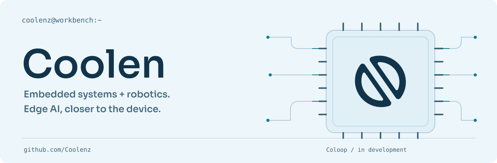
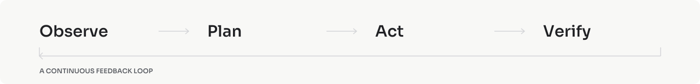
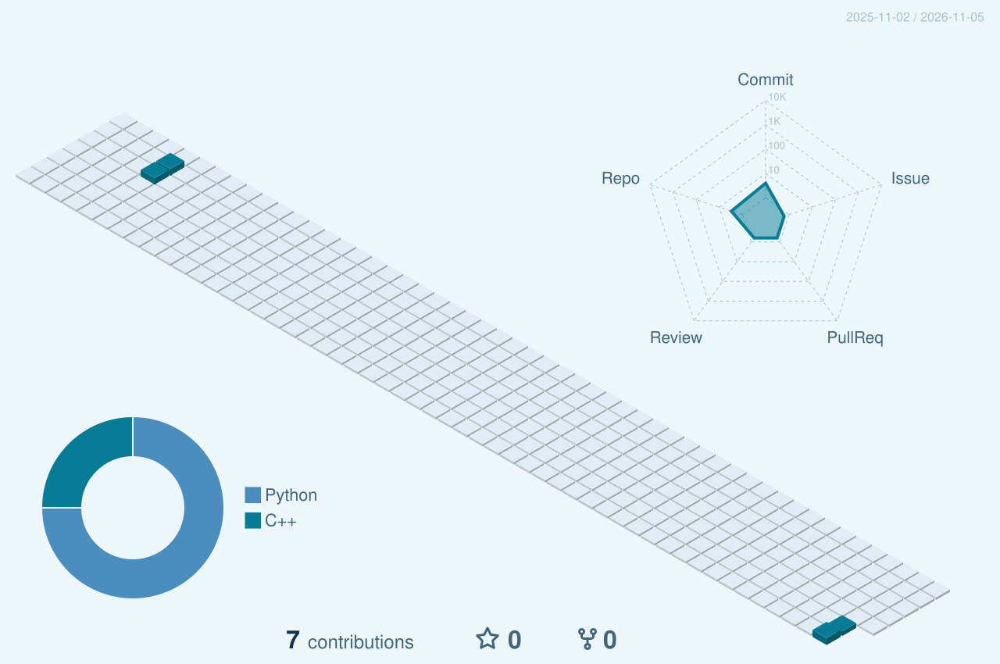

<strong>English</strong> · <a href="./README.zh-CN.md">简体中文</a>

<picture>
  <source media="(prefers-color-scheme: dark)" srcset="./assets/hero-dark.svg">
  
</picture>

### Software meets the physical world.

I'm **Coolen**. I build embedded systems, robotic simulations, and tools that connect AI with physical devices. My work ranges from FreeRTOS motor control to MuJoCo simulation and edge-AI experiments.

[Explore repositories](https://github.com/Coolenz?tab=repositories) &nbsp; / &nbsp; [Read in Chinese](./README.zh-CN.md)

## Current build: Coloop

An ongoing exploration of **AI-assisted computer operation**, connecting a Windows workbench with RK hardware. The project is in active development in a private repository.

<picture>
  <source media="(prefers-color-scheme: dark)" srcset="./assets/loop-dark.svg">
  
</picture>

## Open-source work

**[5-DOF robotic arm simulation](https://github.com/Coolenz/arm-robot-mujoco-simulation)**  
Robotic movement in a simulated environment, built with **Python** and **MuJoCo**.

**[FreeRTOS dual-channel FOC](https://github.com/Coolenz/freeRTOS_FOC)**  
Dual-channel field-oriented motor control in **C++**, including closed-loop position control.

**Embedded** — C++ · FreeRTOS · motor control  
**Robotics** — Python · MuJoCo · simulation  
**Exploring** — edge AI · human–device interaction

## Contribution skyline

<picture>
  <source media="(prefers-color-scheme: dark)" srcset="./profile-3d-contrib/activity-dark.svg">
  
</picture>

Generated daily from public GitHub activity. [Update workflow](https://github.com/Coolenz/Coolenz/actions/workflows/profile.yml).

  
Follow the contribution trace

   
  <picture>
    <source media="(prefers-color-scheme: dark)" srcset="./assets/contribution-trace-dark.svg">
    
  </picture>

---

[All projects](https://github.com/Coolenz?tab=repositories) &nbsp; / &nbsp; [How this profile is built](./PROFILE.md)
