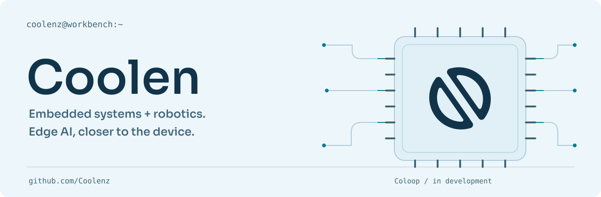

<a href="./README.md">English</a> · <strong>简体中文</strong>

<picture>
  <source media="(prefers-color-scheme: dark)" srcset="./assets/hero-dark.svg">
  
</picture>

# 你好，我是 Coolen。

我在做嵌入式、机器人与端侧 AI 相关的项目。从电机控制、机械臂仿真，到连接软件与实体设备的工具，探索代码如何走进真实世界。

[浏览我的项目 ↗](https://github.com/Coolenz?tab=repositories) · [English →](./README.md)

## 正在构建 Coloop

**让 AI 更靠近设备。**

Coloop 是我对 AI 辅助电脑操作的持续探索，连接 Windows 工作台与 RK 硬件。项目目前在私有仓库中开发。

<picture>
  <source media="(prefers-color-scheme: dark)" srcset="./assets/loop-dark.svg">
  
</picture>

## 公开作品

### [五自由度机械臂仿真 ↗](https://github.com/Coolenz/arm-robot-mujoco-simulation)

使用 **MuJoCo** 与 **Python** 搭建五自由度机械臂仿真，在模拟环境中探索机器人的运动。

### [FreeRTOS 双路 FOC ↗](https://github.com/Coolenz/freeRTOS_FOC)

基于 **FreeRTOS** 与 **C++** 的双路磁场定向电机控制，包含闭环位置控制。

## 技术与探索

**嵌入式** &nbsp; C++ · FreeRTOS · 电机控制  
**机器人** &nbsp; Python · MuJoCo · 仿真  
**正在探索** &nbsp; 端侧 AI · 人与设备的交互

---

让软件与真实世界相遇。 <a href="https://github.com/Coolenz?tab=repositories">在 GitHub 关注项目进展 ↗</a>

